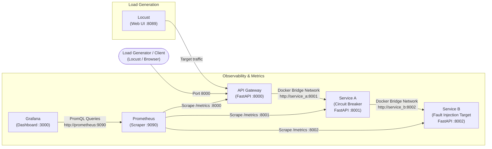
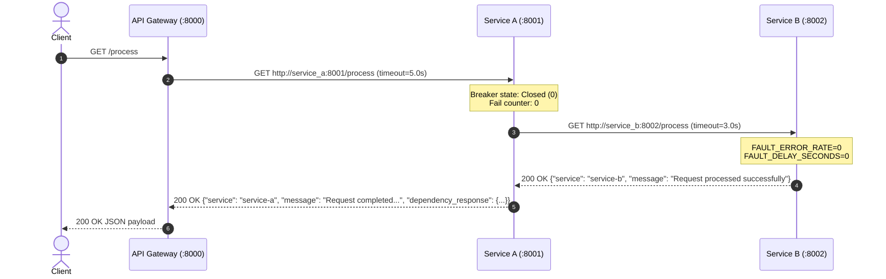
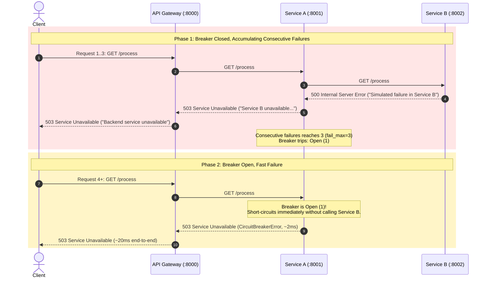
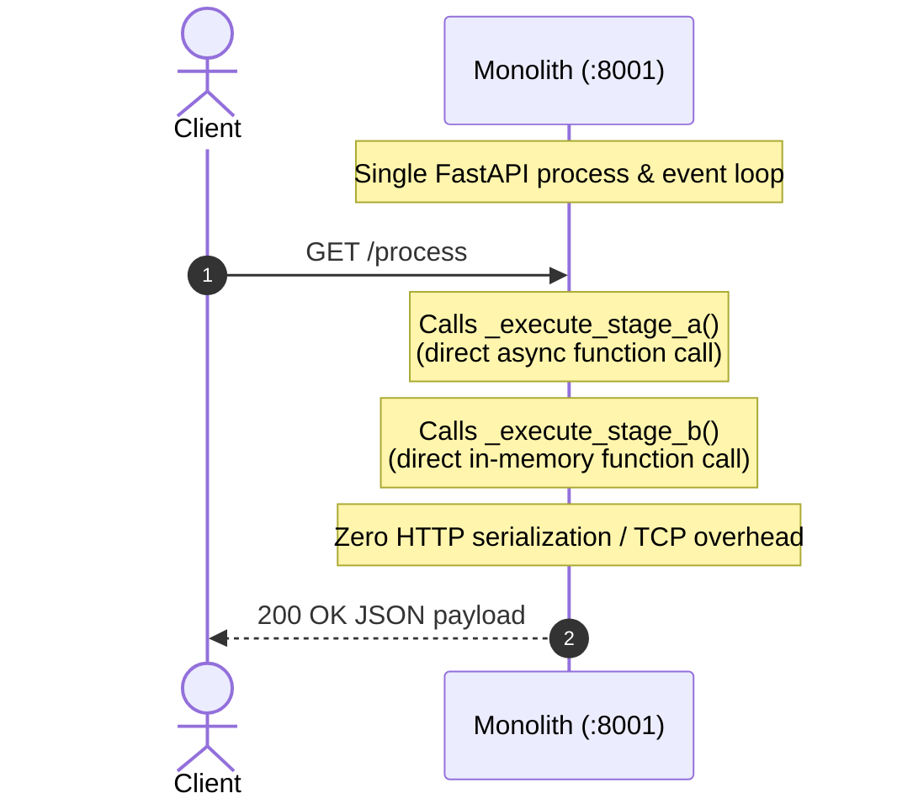

# MicroGuard Architecture & Request Lifecycle

## Overview

**MicroGuard** is a local-first microservices platform designed to demonstrate **fault isolation**, **circuit breaker behavior**, and **real-time observability** in distributed systems.

In distributed microservice architectures, services often form dependency chains where a request flows through multiple downstream components. If a downstream service slows down, becomes unresponsive, or fails, calling services can quickly exhaust system resources (such as HTTP connection pools, event loop workers, and memory) waiting on that failing service. This phenomenon is known as a **cascading failure** (where the failure of one service propagates upward, taking down healthy services across the system).

MicroGuard demonstrates how to prevent cascading failures using:
1. An **API Gateway** as the single entry point.
2. A **Circuit Breaker** on an intermediate service (Service A) that protects the system from an unstable downstream dependency (Service B).
3. **Observability instrumentation** with Prometheus and Grafana to track throughput, error spikes, and circuit breaker transitions in real time.
4. **Automated load testing** with Locust to evaluate system behavior under normal and failing conditions.

---

## Architectural Topology

The core application architecture follows a three-tier synchronous HTTP pipeline:



---

## Component Responsibilities

### 1. API Gateway (`gateway/main.py`)
- **Container Port:** `8000` | **Host Port:** `8000` (`http://localhost:8000`)
- **Role:** Serves as the public ingress into the microservices network.
- **Responsibilities:**
  - Exposes client-facing endpoints (`/`, `/health`, `/process`).
  - Dispatches incoming processing requests to Service A via asynchronous HTTP (`httpx.AsyncClient(timeout=5.0)`).
  - Handles network failures or downstream service errors: catches `httpx.HTTPError` and returns an HTTP `503 Service Unavailable` with `{"detail": "Backend service unavailable"}`.
  - Automatically exposes Prometheus metrics at `/metrics` via `prometheus-fastapi-instrumentator`.

### 2. Service A (`services/service_a/main.py`)
- **Container Port:** `8001` | **Host Port:** Not exposed to the host (internal Docker network only).
- **Role:** Intermediate orchestration service protected by a circuit breaker.
- **Responsibilities:**
  - Receives processing requests from the Gateway at `/process`.
  - Wraps downstream HTTP calls to Service B inside an `aiobreaker.CircuitBreaker` instance.
  - Configured with a failure threshold of `fail_max=3` and a recovery cooldown timeout of `timeout_duration=timedelta(seconds=10)`.
  - Maintains an internal Prometheus Gauge metric named `microguard_circuit_breaker_state` tracking breaker state transitions (0 = Closed, 1 = Open, 2 = Half-Open).
  - If Service B fails repeatedly, the circuit breaker opens and immediately short-circuits subsequent requests, returning HTTP `503` without contacting Service B.
  - Exposes Prometheus metrics at `/metrics`.

### 3. Service B (`services/service_b/main.py`)
- **Container Port:** `8002` | **Host Port:** Not exposed to the host (internal Docker network only).
- **Role:** Leaf downstream dependency and fault injection target.
- **Responsibilities:**
  - Simulates backend business logic and processing.
  - Contains controllable fault injection parameters controlled via environment variables:
    - `FAULT_DELAY_SECONDS`: Injects artificial latency via `asyncio.sleep()`.
    - `FAULT_ERROR_RATE`: A float between `0.0` and `1.0` defining the probability of throwing an HTTP `500 Internal Server Error` (`{"detail": "Simulated failure in Service B"}`).
  - Returns a timestamped health status at `/health` and processing confirmation at `/process`.
  - Exposes Prometheus metrics at `/metrics`.

### 4. Prometheus (`monitoring/prometheus.yml`)
- **Container Port:** `9090` | **Host Port:** `9090` (`http://localhost:9090`)
- **Role:** Time-series metrics collection and storage engine.
- **Responsibilities:**
  - Automatically scrapes the `/metrics` endpoint of `gateway:8000`, `service_a:8001`, and `service_b:8002` every 5 seconds (`scrape_interval: 5s`).
  - Stores standard HTTP request counts, durations, status codes, and the custom `microguard_circuit_breaker_state` gauge.
  - Provides a PromQL query evaluation engine and web UI to inspect metric values and target health.

### 5. Grafana
- **Container Port:** `3000` | **Host Port:** `3000` (`http://localhost:3000`)
- **Role:** Metrics dashboard and visualization layer.
- **Responsibilities:**
  - Connects to Prometheus as its default data source using container networking (`http://prometheus:9090`).
  - Displays real-time charts for Request Rate by Service, HTTP 5xx Error Rate, and Circuit Breaker State.
  - Persists configuration and dashboards inside a named Docker volume (`grafana_data`).

### 6. Locust (`locustfile.py`)
- **Container Port:** `8089` | **Host Port:** `8089` (`http://localhost:8089`)
- **Role:** Load testing framework.
- **Responsibilities:**
  - Executes concurrent user workloads against either `http://gateway:8000/process` or `http://monolith:8001/process`.
  - Measures request throughput, error counts, and latency distribution percentiles (Median, P95).
  - Runs inside a Linux container to bypass Windows-specific DLL execution restrictions.

### 7. Monolith Baseline (`monolith/main.py`)
- **Container Port:** `8001` | **Host Port:** `8001` (`http://localhost:8001`)
- **Role:** Standalone monolithic baseline for empirical performance comparison against the microservices pipeline.
- **Responsibilities:**
  - Implements equivalent business processing to the Gateway -> Service A -> Service B chain, executed in-process.
  - Replaces inter-service HTTP hops and connection pooling with direct in-memory Python function invocations.
  - Produces an identical JSON response schema for successful requests to enable fair comparison.
  - Exposes `/`, `/health`, `/process`, and `/metrics` (via `prometheus-fastapi-instrumentator`).
  - Does NOT implement a circuit breaker, preserving standard monolithic execution semantics.

---

## API Endpoints & Port Exposure

The table below outlines all endpoints across the system and their access boundaries:

| Service | Host Port | Container Port | Endpoint | Method | Purpose |
| :--- | :--- | :--- | :--- | :--- | :--- |
| **API Gateway** | `8000` | `8000` | `GET /` | Client ping / root service metadata |
| | | | `GET /health` | Health check endpoint (`{"status": "healthy"}`) |
| | | | `GET /process` | Public microservices workflow entry point |
| | | | `GET /metrics` | Prometheus metrics scrape endpoint |
| **Monolith Baseline** | `8001` | `8001` | `GET /` | Client ping / root service metadata |
| | | | `GET /health` | Health check with UTC ISO timestamp |
| | | | `GET /process` | In-process unified processing entry point |
| | | | `GET /metrics` | Prometheus metrics scrape endpoint |
| **Service A** | *None* | `8001` | `GET /` | Internal root service metadata |
| | | | `GET /health` | Internal health check |
| | | | `GET /process` | Calls Service B via Circuit Breaker |
| | | | `GET /metrics` | Prometheus metrics scrape endpoint |
| **Service B** | *None* | `8002` | `GET /` | Internal root service metadata |
| | | | `GET /health` | Health check with UTC ISO timestamp |
| | | | `GET /process` | Simulated backend work (fault injection target) |
| | | | `GET /metrics` | Prometheus metrics scrape endpoint |
| **Prometheus** | `9090` | `9090` | `GET /` | Prometheus Web UI and Target Status |
| | | | `GET /metrics` | Internal Prometheus self-metrics |
| | | | `POST/GET /api/v1/*` | PromQL query evaluation API |
| **Grafana** | `3000` | `3000` | `GET /` | Grafana Web UI and Dashboards |
| **Locust** | `8089` | `8089` | `GET /` | Locust Web UI for load test control |

> [!NOTE]
> Services A and B do not expose host ports in `docker-compose.yml`. They reside exclusively on the private Docker bridge network. External traffic can only reach them through the Gateway on port `8000`. The Monolith Baseline binds host port `8001` for direct isolated benchmarking.

---

## Request Lifecycle Walkthroughs

### 1. Healthy End-to-End Request (Normal Operation)



1. **Client** issues an HTTP `GET /process` request to `http://localhost:8000/process`.
2. **API Gateway** receives the request and executes `httpx.AsyncClient(timeout=5.0).get("http://service_a:8001/process")`.
3. **Service A** inspects its circuit breaker. The breaker is **Closed (0)**, so it invokes `call_service_b()` through `breaker.call_async()`.
4. **Service A** issues an HTTP `GET http://service_b:8002/process` request with a 3.0s client timeout.
5. **Service B** evaluates fault injection settings (`FAULT_ERROR_RATE=0`). It does not inject delay or errors, and returns HTTP `200 OK` with:
   ```json
   {
     "service": "service-b",
     "message": "Request processed successfully"
   }
   ```
6. **Service A** wraps the dependency response:
   ```json
   {
     "service": "service-a",
     "message": "Request completed through Service B",
     "dependency_response": { ... }
   }
   ```
7. **API Gateway** checks `response.raise_for_status()`, passes the JSON response back to the client with HTTP `200 OK`.

---

### 2. Failure & Circuit Breaker Trip (Fault Injection)

When `FAULT_ERROR_RATE=1.0` is configured on Service B:



1. **Failure Accumulation:** The first 3 consecutive requests reach Service B, which returns HTTP `500`. Service A catches the exception, increments the breaker's failure counter, and returns HTTP `503`.
2. **Breaker Trips:** On the 3rd consecutive failure, `aiobreaker` trips the circuit breaker to **Open (1)**. Service A's `CircuitStateMetrics` listener updates the Prometheus gauge `microguard_circuit_breaker_state` to `1`.
3. **Fast Failure:** For all subsequent requests during the next 10 seconds (`timeout_duration`), Service A **never contacts Service B**. It immediately rejects requests with an internal `CircuitBreakerError`, returning HTTP `503` in single-digit milliseconds.
4. **Recovery Evaluation:** After 10 seconds, the breaker enters **Half-Open (2)**, permitting a single probe request through to Service B. If Service B succeeds, the breaker resets to **Closed (0)**. If it fails, the breaker trips back to **Open (1)**.

---

### 3. Monolithic Request Lifecycle (In-Process Baseline)



1. **Client** issues `GET /process` directly to `http://localhost:8001/process`.
2. **Monolith ASGI Server** dispatches to the FastAPI endpoint handler.
3. The handler executes `_execute_stage_a()`, which invokes `_execute_stage_b()` within the same Python process and event loop.
4. If fault injection is configured:
   - `FAULT_DELAY_SECONDS`: simulated via `await asyncio.sleep()`.
   - `FAULT_ERROR_RATE`: raises `HTTPException(status_code=500)` directly within the request handler.
5. In normal conditions, the response returns HTTP `200 OK` with the exact JSON payload format matching the microservices gateway response.

---

## Architectural & Empirical Comparison

To align with the research methodology of *Evaluating The Impact Of Cloud-Based Microservices Architecture On Application Performance*, the table below contrasts the microservices pipeline and the monolithic baseline:

| Dimension | Microservices Pipeline (`:8000`) | Monolithic Baseline (`:8001`) | Research Impact |
| :--- | :--- | :--- | :--- |
| **Process Model** | 3 independent OS processes / containers (Gateway, Service A, Service B) | 1 OS process / container (`monolith`) | Lower process memory footprint and CPU context switching in monolith. |
| **Inter-Component Transport** | Network I/O (TCP sockets over Docker bridge network, HTTP/1.1 via `httpx`) | Direct Python in-memory asynchronous function calls | Eliminates ~5-15ms network latency per hop and TCP packet overhead. |
| **Data Serialization** | Multiple JSON serialize/deserialize cycles across service boundaries | Direct in-memory Python dictionaries (zero intermediate serialization) | Reduces CPU overhead during high request swarms. |
| **Failure Handling** | Service A `aiobreaker` Circuit Breaker with 503 fast-fail isolation | Direct exception propagation (HTTP 500 on unhandled fault) | Microservices isolate downstream faults; monolith fails request immediately. |
| **Telemetry & Metrics** | 3 separate Prometheus scrape jobs (`gateway`, `service_a`, `service_b`) | 1 unified Prometheus scrape job (`monolith`) | Per-service observability vs single-service consolidated metrics. |
| **Scaling Granularity** | Each service can be horizontally scaled independently | Entire application must be scaled as a single unit | Microservices optimize resource allocation under asymmetric load. |

---

## Next Steps

- Review container setup in the [Docker Guide](docker.md).
- Learn how metrics are scraped in [Prometheus Monitoring](prometheus.md).
- Inspect dashboard metrics in [Grafana Dashboards](grafana.md).
- Understand load testing with [Locust Load Testing](locust.md).
- Explore breaker mechanics in [Fault Tolerance & Circuit Breakers](fault-tolerance.md).
- Read the test run analysis in [Load Test Experiments](experiments.md).
- Return to the [MicroGuard Root README](../README.md).

