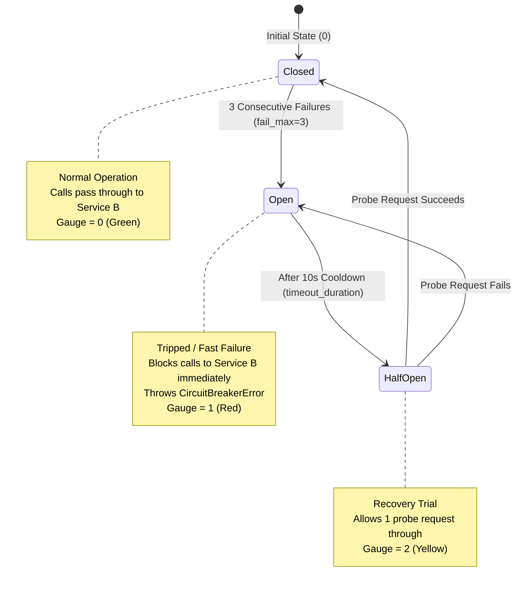

# Fault Tolerance & Circuit Breaker Architecture

## What is Fault Tolerance?

In software architecture, **fault tolerance** refers to the ability of a distributed system to remain operational, isolate failures, and prevent complete system collapse when one or more of its underlying components fail.

In a synchronous microservice chain like:
```text
Client ──> API Gateway ──> Service A ──> Service B
```
If Service B becomes unresponsive or starts throwing errors, Service A and the API Gateway can suffer from **resource starvation**:
- Worker threads and asynchronous event loops remain blocked waiting for network timeouts.
- Inbound connection pools are depleted.
- The failure of Service B cascades upward, causing Service A and the API Gateway to crash or freeze.

Fault tolerance ensures that when Service B fails, the rest of the system **detects the failure, stops sending futile requests, and fails fast** to protect healthy infrastructure.

---

## Fault Injection in MicroGuard

**Fault injection** is the deliberate, controlled introduction of errors and latency into a system to test and validate its resilience mechanisms under realistic failure conditions.

In MicroGuard, fault injection is implemented directly within [services/service_b/main.py](../services/service_b/main.py) and configured via environment variables:

```python
FAULT_DELAY_SECONDS = float(os.getenv("FAULT_DELAY_SECONDS", "0"))
FAULT_ERROR_RATE = float(os.getenv("FAULT_ERROR_RATE", "0"))

@app.get("/process")
async def process():
    if FAULT_DELAY_SECONDS > 0:
        await asyncio.sleep(FAULT_DELAY_SECONDS)

    if random.random() < FAULT_ERROR_RATE:
        raise HTTPException(
            status_code=500,
            detail="Simulated failure in Service B"
        )

    return {
        "service": "service-b",
        "message": "Request processed successfully"
    }
```

### Configuration Parameters (in `docker-compose.yml`)
- **`FAULT_DELAY_SECONDS`:** Adds artificial delay in seconds using `asyncio.sleep()`. Default: `"0"`.
- **`FAULT_ERROR_RATE`:** A float between `0.0` (0% failures) and `1.0` (100% failures). When `random.random() < FAULT_ERROR_RATE`, Service B immediately throws an HTTP `500 Internal Server Error`.

---

## Circuit Breaker Implementation (`aiobreaker`)

MicroGuard protects downstream communication to Service B using the `aiobreaker` asynchronous circuit breaker library in [services/service_a/main.py](../services/service_a/main.py):

```python
from datetime import timedelta
from aiobreaker import CircuitBreaker, CircuitBreakerListener
from prometheus_client import Gauge

circuit_state = Gauge(
    "microguard_circuit_breaker_state",
    "Circuit breaker state: 0=closed, 1=open, 2=half-open",
)

class CircuitStateMetrics(CircuitBreakerListener):
    def state_change(self, breaker, old, new):
        state = str(new).lower()
        if "half" in state:
            circuit_state.set(2)
        elif "open" in state:
            circuit_state.set(1)
        else:
            circuit_state.set(0)

breaker = CircuitBreaker(
    fail_max=3,
    timeout_duration=timedelta(seconds=10),
)

breaker.add_listener(CircuitStateMetrics())
circuit_state.set(0)
```

### Circuit Breaker Parameters
1. **`fail_max = 3` (Failure Threshold):**
   If 3 consecutive requests to Service B result in an exception (HTTP 500 error or network timeout), the circuit breaker transitions from **Closed** to **Open**.
2. **`timeout_duration = timedelta(seconds=10)` (Cooldown Window):**
   Once tripped, the circuit breaker remains **Open** for exactly 10 seconds. During this window, all calls to Service B are blocked immediately.
3. **`add_listener(CircuitStateMetrics())`:**
   Hooks into `aiobreaker`'s state machine. Every time the breaker shifts state, it immediately publishes the new state value to Prometheus.

---

## The Three States of a Circuit Breaker



### 1. Closed (State `0`)
- **Condition:** Normal, healthy operation.
- **Behavior:** All requests pass through to Service B.
- **Failure Handling:** If a request fails, the internal failure counter increments. If a successful response is received before reaching `fail_max`, the failure counter resets to zero.
- **Gauge Value:** `0` (Displayed as **Closed** / Green in Grafana).

### 2. Open (State `1`)
- **Condition:** Service B has failed 3 consecutive times.
- **Behavior (Fast Failure):** Service A **never makes a network call to Service B**. The breaker immediately raises `CircuitBreakerError`, which Service A catches and converts into an HTTP `503 Service Unavailable`.
- **System Protection:** Prevents overloading a struggling Service B and frees up Service A and Gateway worker resources within milliseconds.
- **Gauge Value:** `1` (Displayed as **Open** / Red in Grafana).

### 3. Half-Open (State `2`)
- **Condition:** The 10-second cooldown has expired.
- **Behavior:** The circuit breaker allows the **very next incoming request** to pass through as a trial probe to Service B:
  - If the probe **succeeds**: Service B is deemed healthy. The breaker resets to **Closed (0)**.
  - If the probe **fails**: The breaker immediately trips back to **Open (1)** for another 10 seconds.
- **Gauge Value:** `2` (Displayed as **Half-Open** / Yellow in Grafana).

---

## End-to-End Error Propagation

When a failure occurs, errors propagate strictly through standard HTTP status codes:

```
[Service B]
    │  random.random() < FAULT_ERROR_RATE
    ▼
Throws HTTPException(status_code=500, detail="Simulated failure in Service B")
    │
    ▼ (HTTP 500 over Docker bridge network)
[Service A]
    │  httpx.AsyncClient raises httpx.HTTPStatusError
    │  or breaker raises CircuitBreakerError (if Open)
    ▼
Throws HTTPException(status_code=503, detail="Service B unavailable or circuit breaker open: ...")
    │
    ▼ (HTTP 503 over Docker bridge network)
[API Gateway]
    │  httpx.AsyncClient catches httpx.HTTPError
    ▼
Throws HTTPException(status_code=503, detail="Backend service unavailable")
    │
    ▼ (HTTP 503 to Client)
[Client / Locust / Browser]
Receives HTTP 503 Service Unavailable
```

> [!IMPORTANT]
> **Actual System Behavior Notice:**
> MicroGuard implements pure **fast failure** via circuit breaking. It does **not** implement automated retries, fallback responses (such as returning stale cache data or mock responses), or alternative backend routing. When downstream fails or the breaker is open, requests return HTTP 503.

---

## Fast Failure vs Successful Availability

A common misconception when reviewing load test data is confusing **fast response time** with **good service performance**.

| Metric Dimension | Normal Operation | Fault Injection (Open Breaker) |
| :--- | :--- | :--- |
| **Response Status** | `200 OK` | `503 Service Unavailable` |
| **Median Response Time** | ~35 ms | ~21 ms |
| **Work Done** | Full pipeline: Gateway + Service A + Service B | Short-circuited at Service A |
| **Service Availability** | 100% Available | Unavailable (Failing Fast) |

- **Why is latency lower during fault injection?**
  When the circuit breaker is open, Service A does not wait for network I/O to Service B. It rejects the request instantly in memory.
- **Why is fast failure beneficial?**
  Failing fast ensures that while Service B is down, the API Gateway and Service A remain responsive and consume almost zero CPU and connection resources, preventing system-wide crashes.

---

## Step-by-Step: Performing a Fault Injection Test

Follow these exact steps in Windows PowerShell to test circuit breaker behavior and safely restore normal operations:

### Step 1: Verify Baseline State
Verify that the circuit breaker is currently closed:
```powershell
curl.exe -s "http://localhost:9090/api/v1/query?query=microguard_circuit_breaker_state"
```
The query output should contain `"value": [timestamp, "0"]`.

---

### Step 2: Inject Fault into Service B
Open `docker-compose.yml` in your editor and update `service_b.environment`:
```yaml
  service_b:
    build: .
    command: uvicorn services.service_b.main:app --host 0.0.0.0 --port 8002
    environment:
      FAULT_DELAY_SECONDS: "0"
      FAULT_ERROR_RATE: "1.0"
```

Recreate the `service_b` container to apply the updated environment variable:
```powershell
docker compose up -d service_b
```

---

### Step 3: Trigger the Circuit Breaker
Send 5 consecutive requests through the Gateway:
```powershell
1..5 | ForEach-Object {
    $res = curl.exe -s http://localhost:8000/process
    Write-Host "Response: $res"
}
```

**What happens:**
1. Requests 1, 2, and 3 reach Service B, receive HTTP 500, and Service A logs consecutive failures.
2. After the 3rd failure (`fail_max=3`), the circuit breaker trips to **Open**.
3. Requests 4 and 5 fail fast with `CircuitBreakerError` without reaching Service B.

---

### Step 4: Verify the Breaker Opened in Prometheus & Grafana
1. Run the Prometheus query:
   ```powershell
   curl.exe -s "http://localhost:9090/api/v1/query?query=microguard_circuit_breaker_state"
   ```
   The metric will now return `"1"`.
2. Open Grafana (`http://localhost:3000`). The **Circuit Breaker State** panel will display **Open** in bright red.

---

### Step 5: Safe Restoration Steps (Do Not Leave Broken!)
To return the environment to healthy operation:

1. Edit `docker-compose.yml` and reset `FAULT_ERROR_RATE` back to `"0"`:
   ```yaml
   environment:
     FAULT_DELAY_SECONDS: "0"
     FAULT_ERROR_RATE: "0"
   ```
2. Recreate `service_b` with the clean configuration:
   ```powershell
   docker compose up -d service_b
   ```
3. **Wait 10 seconds:** Let the 10-second `timeout_duration` expire so the breaker enters **Half-Open (2)**.
4. Send a single probe request to trigger recovery:
   ```powershell
   curl.exe -s http://localhost:8000/process
   ```
   Response:
   ```json
   {
     "service": "service-a",
     "message": "Request completed through Service B",
     "dependency_response": {
       "service": "service-b",
       "message": "Request processed successfully"
     }
   }
   ```
5. Confirm that the Prometheus metric has reset to `0`:
   ```powershell
   curl.exe -s "http://localhost:9090/api/v1/query?query=microguard_circuit_breaker_state"
   ```
   Grafana will show the panel return to **Closed** in green.

---

## Related Documentation

- Architectural request flow: [Architecture Guide](architecture.md)
- Container runtime setup: [Docker Guide](docker.md)
- Prometheus metrics: [Prometheus Monitoring](prometheus.md)
- Dashboard panel setup: [Grafana Dashboards](grafana.md)
- Load testing under fault conditions: [Locust Load Testing](locust.md)
- Load testing experiment comparison: [Load Test Experiments](experiments.md)
- Main project page: [Root README](../README.md)
